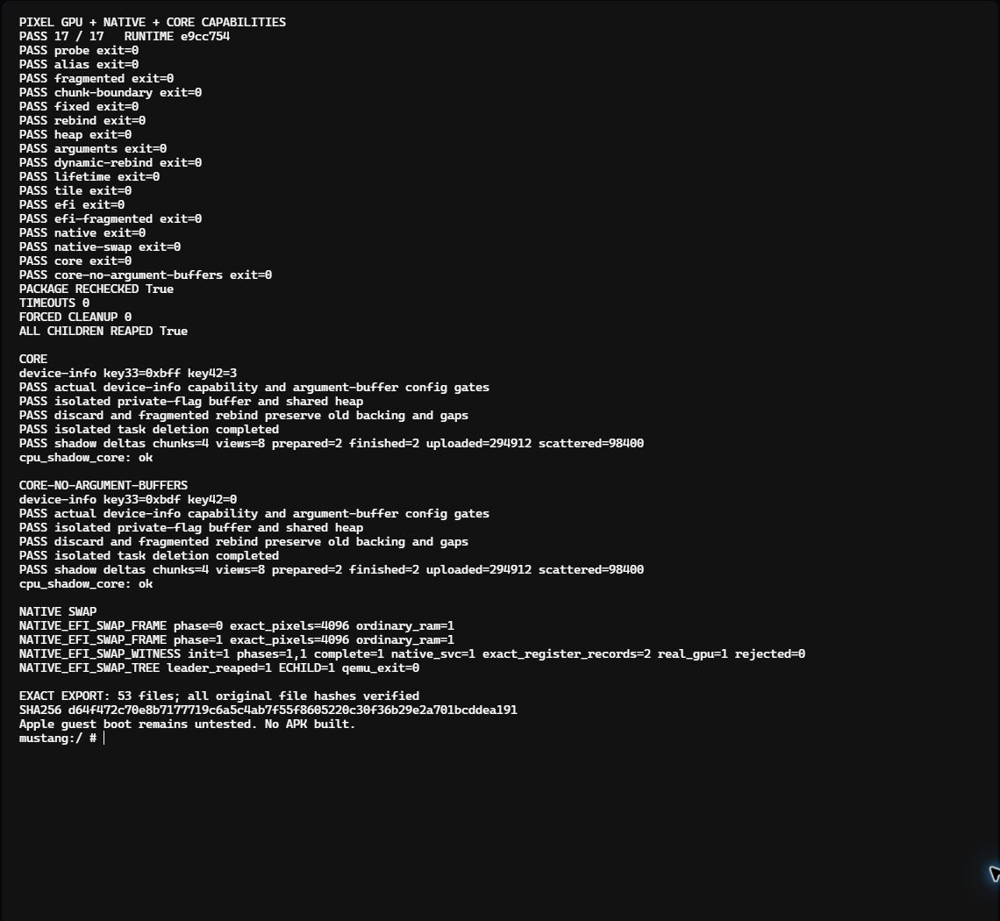

# Physical Pixel run with core resource capabilities

**Status: `DEVICE_AUTHORED_SUITE_PASS` — all 17 cases passed in one run.**
The experimental reims `e9cc754` candidate ran on the Pixel 10 Pro XL's system
PowerVR D-Series DXT-48-1536 MC1 driver. The existing fifteen cases and both new
C API/MMIO cases passed, with argument buffers enabled and disabled. Every case
exited zero, stayed within its deadline, and reaped all children without forced
cleanup. All 36 package files were verified during installation; the runner
rechecked its complete checksum list after execution.

[`summary.json`](summary.json) records exact sources, binaries, device/driver,
package, case results and evidence hashes. The recorded interval was 8.990135
seconds, a diagnostic duration rather than an iOS boot or performance benchmark.
The fresh challenged C API probe passed all seven checks on Vulkan 1.4.344,
vendor 4112, device 1896223250, driver 6967606.

## Newly exercised guest-facing resource paths

The candidate enables buffer address ranges, heap address ranges and backing
detach only for explicitly selected CpuShadow. CpuShadow remains opt-in; the
host-import and absent-backend answers are unchanged. The source patch remains
separate under [`cpu-shadow-capabilities`](../../../../patches/cpu-shadow-capabilities/README.md).

The authored C program uses the real C API, MMIO/FIFO, isolated-task handshake
and core resource constructors. Both configurations created a private-flag
buffer and shared heap child, checked GPU copies/fills, discarded and rebound
the same resource objects to fresh fragmented backing, verified exact old/new
bytes and untouched gaps, and completed isolated-task deletion. Both required
completed GPU shadow epochs as well as CPU-visible byte comparisons.

| Physical witness | Argument buffers enabled | Argument buffers disabled |
|---|---:|---:|
| Device-info key 33 | `0xbff` | `0xbdf` |
| Affected key-33 mask `0x38` | `0x38` | `0x18` |
| Device-info key 42 | `3` | `0` |
| Shadow chunks / views | `4 / 8` | `4 / 8` |
| Prepared / finished epochs | `2 / 2` | `2 / 2` |
| Bytes uploaded / scattered | `294912 / 98400` | `294912 / 98400` |

The [host results](../../host-checks/core-capabilities-e9cc754/README.md) reported
key 33 as `0xabf` and `0xa9f`. The same `0x140` difference in both configurations
is the unchanged device-derived SIMD reduction (`0x40`) and shuffle/fill
(`0x100`) flags. The affected capability gates agree across host and Pixel;
the argument-buffer toggle changes only `0x20` and key 42. Resource detach has
no separate key-33 bit: construction and the actual discard/rebind path exercise
it. These cases do not dispatch a guest-framework argument-buffer shader or
independently establish every SIMD operation reported by the device audit.

## Existing native and GPU coverage retained

The other fifteen cases passed again: the installed probe; alias, fragmented
and chunk-boundary addresses; fixed-function operations; buffer and heap
replacement; argument handles and dynamic rebinding; lifetimes; authored tile
rendering; contiguous and fragmented EFI frames; generic-trap native EL0; and
the iOS TPIDRRO swap-mode native fixture. All four native fixture binaries are
byte-identical to the previous fifteen-case package.

The swap fixture again observed thread-data pointers `0x100008100` and
`0x100008140`, loaded values `0x123456789abc0000` and `0x123456789abc0001`, native
TPIDR CPU hints of zero, and saved guest TPIDR sentinels `0x56780000` and
`0x56780001`. Saved TPIDRRO, read PC `0x10000007c`, and SVC-return PC
`0x100000094` matched. QEMU recorded two native entries and two SVC returns.
The supervisor checked all 4,096 pixels in each of two frames and reached
`ECHILD` after QEMU exited zero.

This run completed an additional third GPU presentation before shutdown:
QEMU's final counters are three prepared/finished epochs and 49,152 uploaded
bytes. The supervisor's exact pixel comparisons still cover two frames.
The authored native fixture uses one worker and two entries; it does not
establish a larger native worker pool, PAC instruction execution or app-UID use.

## Exact build, reconstruction and evidence

The QEMU, EFI and core build records use the same static runtime archive
`0a8416777ccf33c5fadc461875fe93140458ced5c01061f423b9df67223e1914`
and C header
`da1dc6eb2b616fb17ccac2a9a5ddfac14c5c735b0965beb0478e376f80e5aad7`.
The packaged runtime linkage record and independent
[`host reconstruction receipt`](build/host-installer-rehearsal.json) bind those
records to the actual library/header and executable hashes. The original reims
integration branch was restored at `afdbdd0`; only a temporary detached build
used the experimental candidate. Its machine-local Cargo overrides were preserved.

The 4,989,821-byte v3 update archive has SHA-256
`bc0e83bfbfe85f995c838c37223e3daae7e750cbdd10e09194691e84708e3d7e`;
its update manifest is
`b1fecd111546eae702a445b0225ff79316bf81a1b297a8d29c7e775d2919a926`.
Actual host and phone reconstruction verified all 36 files and rechecked the
unchanged baseline. The named 2,315,743-byte delta used the verified older EFI
binary to reconstruct the new 40,749,216-byte core fixture. The terminal
receiver saved and acknowledged all 26 parts before checking the complete ZIP.

The `raw/` directory preserves **all 53 exported UTF-8 files byte for byte**,
including the phone's 52-file export manifest, every case result/log, both
native QEMU logs, transfer/installation receipts and all runtime build records.
[`raw-sha256.json`](raw-sha256.json) covers the complete export. Its 48,525-byte
compressed form has SHA-256
`d64f472c70e8b7177719c6a5c4ab7f55f8605220c30f36b29e2a701bcddea191`.
Every original file hash, case-log hash, required marker, package identity and
native register record was checked after copying.

Installation/build records retain their original not-yet-executed status;
the later execution evidence is
[`qualification.json`](raw/qualification-e9cc754/qualification.json).
The phone run did not request Vulkan validation layers. The zero-validation-error
claim belongs to the separately recorded host synchronization-validation run.
Runtime precision and unavailable-core-count notices remain in the exact logs;
passing these authored workloads does not establish full Metal conformance.
No Apple binaries, guest shader code or serialized Apple descriptors are included.

## Resume here

| Source | Committed revision |
|---|---|
| reims experimental candidate | `e9cc7541e4edee4896d9564b3056bb2799595d3f` |
| reims complete tree | `c191491d2ca8a1224d0f55bd14ecec4fcdf170da` |
| metal2vulkan | `51c322d883ea723d290c931b3b2013c50f5e4934` |
| QEMU | `755b88fad8a2771a8e3e207133a54898b740cd7f` |
| App source before this evidence | `f5fabe6a6ea5d0383c2b096626996f3ce2caa19c` |

- Phone package: `/data/local/tmp/pixel-gpu-transfer-sxtv33sh/pixel-cpu-shadow-ksceynt6/cpu-shadow-qualification`
- Phone results: `/data/local/tmp/pixel-gpu-transfer-sxtv33sh/qualification-e9cc754`
- Phone installation receipt: `/data/local/tmp/pixel-gpu-transfer-sxtv33sh/installed-e9cc754.json`
- Local package: `/tmp/pixel-cpu-shadow-package-e9cc754/cpu-shadow-qualification`
- Local original export: `/workspace/scratch/3ef77e3b5dde/native-runtime-build/device-core-run-e9cc754`
- QEMU SHA-256: `e7dd143c27b6a320fa61954d53e35abcf515dbaa7b9b3fdd11a6da4017b8018c`

The seventeen-case prerequisite and same-runtime correspondence are now
established for this candidate. Next use the
[`cold-boot harness`](../../IOS26-COLD-BOOT.md) with a coherent prepared iOS26
image set and Android qemu-img, preserving these logs and the verified package.
The earlier [read-only phone preflight](../swap-run-2a04355/raw/ios26-preflight-swap-2a04355.json)
found no guest assets, installed ASoft app or resumable setup in the checked
locations. No actual Apple guest boot has been performed.

Cold Apple-guest behavior, app-UID execution and final proof binding, broader
native coverage, and the required full integration checks remain open. Keep
the capability source candidate experimental until its integration gates pass.
The app proof asset is absent, `gpu_path_complete` is false, and no final APK
has been built.
