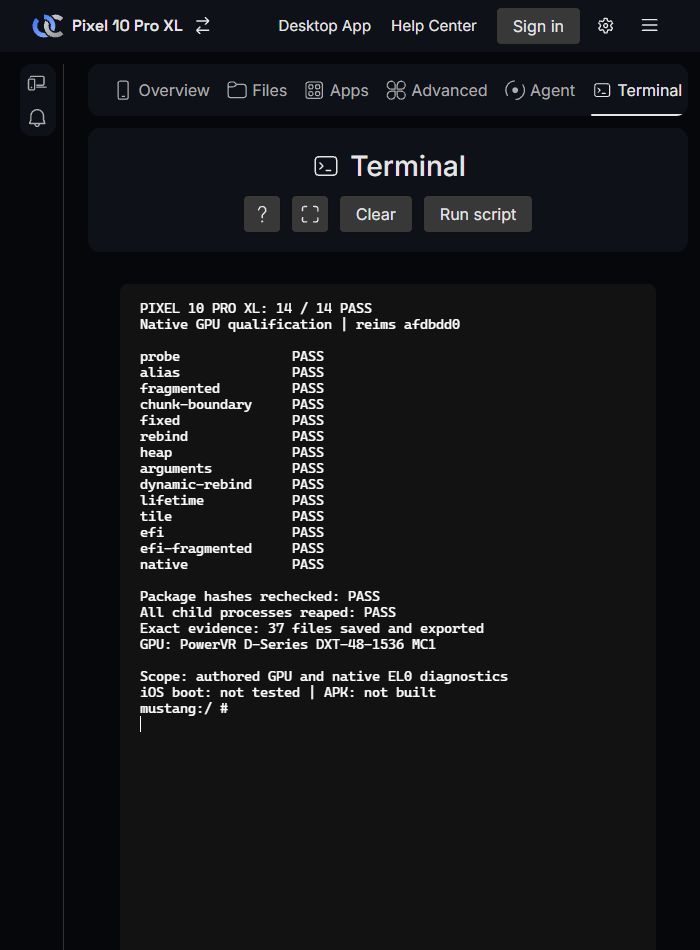

# Complete physical Pixel diagnostic run

**Status: `DEVICE_AUTHORED_SUITE_PASS` — all 14 cases passed in one run.**
The exact recovered Android candidate ran on the Pixel 10 Pro XL's system
PowerVR D-Series DXT-48-1536 MC1 driver. The suite's recorded start-to-finish
interval was **7.529476 seconds**, with no timeouts, no forced descendant cleanup
and all children reaped. This is diagnostic elapsed time, not a boot benchmark.

[`summary.json`](summary.json) links every case to its exact original report and
log, records executable and package hashes, and preserves the complete device
and driver identity. The installed probe reported Vulkan 1.4.344, vendor ID
4112 (`0x1010`), device ID 1896223250 and driver version 6967606. Its seven checks
passed with completed GPU epochs and an independently verified challenge.

| Cases | Observed result |
|---|---|
| probe | All seven installed-runtime checks; exact hardware identity and GPU work counters. |
| alias, fragmented, chunk-boundary | Exact ordinary-file comparisons, independent CPU edits preserved, and completion after scatter. |
| fixed, rebind, heap | Fixed-function rendering/copies, stable resource identities, replacement backing and untouched old backing. |
| arguments, dynamic-rebind, lifetime | Texture/sampler handles, all seven dynamic-rebind subcases, and pending/in-flight lifetime checks. |
| tile | Both authored tile cases, 2,048 checked pixels, expected execution records and preserved padding. |
| efi, efi-fragmented | Three exact frames each, including CPU refresh and remap, with no changed row padding. |
| native | Two exact 64×64 frames, two native entries/SVC returns, two TPIDRRO witnesses and `ECHILD`. |

The native case used the **generic authored-guest TPIDRRO trap mode**, with code
copied into a memfd. It did not test iOS TPIDRRO swap mode or boot an Apple guest.
The hardware run did not request Vulkan validation layers; separate host
validation evidence remains under `host-checks`. The capability trio remains
false for CPU-shadow, the app qualification asset is absent, and no APK was built.

## Exact evidence

The `raw/` directory preserves all **37 exported UTF-8 files byte for byte**.
The phone's original manifest lists 36 files; the extra file is that manifest
itself. [`raw-sha256.json`](raw-sha256.json) covers all 37, including all fourteen
case logs/results, the aggregate qualification, native QEMU output, installation
records, package manifests and receiver checkpoint. Every original manifest
entry, case record, log hash and required marker was checked. All text also
matches the verified 16,746-byte compressed export. The exported package
identities match the locally recovered candidate and all 31 package files.

The installation and package records keep their earlier build/installation
statuses. The subsequent execution result is in
[`raw/qualification-afdbdd0/qualification.json`](raw/qualification-afdbdd0/qualification.json).
The earlier partial run and `android-build-checkpoint.json` remain unchanged.
The text and screenshot contain authored diagnostics, synthetic display IDs,
device/build/driver details, owned test paths and VM addresses; no credentials,
personal content or Apple guest binaries were found.

## Resume here

| Source | Exact committed revision |
|---|---|
| reims | `afdbdd0c3c13710bf0565ef9365f0a9d890b207d` |
| metal2vulkan | `51c322d883ea723d290c931b3b2013c50f5e4934` |
| QEMU | `755b88fad8a2771a8e3e207133a54898b740cd7f` |

The verified update is 5,444,509 bytes, SHA-256
`3cca1218b32aba2836275fd3825562dbe65adf72dbb0aa1f9a2c75a4042b61da`.
Its update-manifest SHA-256 is
`802c759d702e708efadb4391c823ecc84fc71288c0d170bf37f4ae63e365160f`.
The complete package manifest is
`70265eba9b7688b61e3ae8907abdac455072a4df0fd3426957809ceb5456ecd8`.
Local artifact locations and executable hashes are in
[`../../recovery-afdbdd0.json`](../../recovery-afdbdd0.json).

- Tested phone package: `/data/local/tmp/pixel-gpu-transfer-sxtv33sh/pixel-cpu-shadow-s5x1jdxx/cpu-shadow-qualification`
- Phone results: `/data/local/tmp/pixel-gpu-transfer-sxtv33sh/qualification-afdbdd0`

Next steps:

1. Prepare a separate candidate with the resource capability trio enabled.
2. Add and run a fixture for the actual iOS TPIDRRO swap path.
3. Run the full suite on the exact final candidate, then cold-boot the Apple
   guest using a disk overlay. Keep the original guest disk unchanged.
4. Bind app qualification to the passing runtime hashes and device/driver
   identity, then build the APK.

This checkpoint stops before those changes. The complete authored suite is now
proven on this candidate; the product launch and Apple guest boot remain the
next qualification work.
