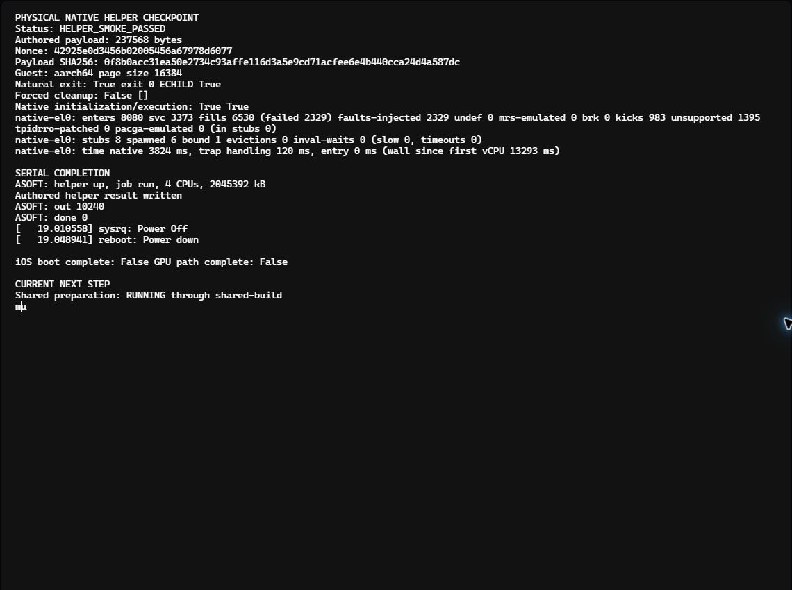

# Physical standalone tooling and native helper checkpoint

**The authored native Linux helper passed on the Pixel on 2026-11-22.** The
separate Android image-tool and current Java/JNI probes also passed. This is a
preparation checkpoint using the same `e9cc754` runtime as the seventeen-case
GPU package. It is not an iOS boot or app-UID qualification.

`raw/` preserves all 28 exported files, 118,554 bytes in total, without edits.
Both the root review and an independent review checked every length and hash in
`raw-manifest.json` and `raw-sha256.txt`. The compressed phone export is
45,145 bytes, SHA256
`ddfefa7f67c3859718c588a49b73eb68768caf0c223fe84f14b78d68617bc0b1`.

## Observed results

| Check | Observed result |
|---|---|
| Tool reconstruction | 121 files, 65,004,941 bytes; exact frozen manifest; DEX mode `0444` |
| Android image tool | `qemu-img version 11.1.0 (ASoftware-android)`, exit 0 |
| Current Java/JNI | Explicit `COMPLETE` result, exit 0, exact 66-byte authored output |
| Linux helper | `HELPER_SMOKE_PASSED`, aarch64, 16,384-byte pages |
| Authored helper payload | Exact nonce and SHA256 for 237,568 bytes |
| Native activity | 8,080 entries and 3,373 SVCs |
| Helper protocol | One `ASOFT: out 10240`, one `ASOFT: done 0`, guest power-off |
| Process ownership | Natural exit 0, `ECHILD`, no forced QEMU/descendants or cleanup errors |

The helper nonce is `42925e0d3456b02005456a67978d6077`; the independently
recomputed payload SHA256 is
`0f8b0acc31ea50e2734c93affe116d3a5e9cd71acfee6e4b440cca24d4a587dc`.
The helper used 2,048 MiB guest RAM, four vCPUs, eight native stubs, ordinary
Linux TPIDR_EL0 TLS and the 16 KiB helper kernel. Both TPIDRRO swap and trap
selectors were absent. No Apple inputs or network requests were used by this
authored helper job.

The VM start/finish timestamps span 20.667634 seconds; the outer command spans
21.682310 seconds. The original runner did not refresh `elapsed_seconds` at
finalization, leaving its last 10.019-second polling value. The raw record is
preserved. A separate telemetry-only source fix refreshes this value for future
runs; it does not change launch settings, success gates or cleanup.

The final stderr also records 2,329 failed fills/injected faults, 1,395
unsupported native events, and trapped TPRO reads because SSBS is unavailable.
This establishes hybrid native EL0 execution, not an entirely native or
trap-free workload. QMP stop/quit flags are false because the helper had already
powered off naturally. No GPU work or frames were expected in this job.

The Java fixture is an authored IM4P containing an **uncompressed LZFSE block**.
It establishes the actual Android loader/JNI decoding route for that fixture.
It does not independently exercise compressed LZFSE streams, AEA authentication,
hole punching, directory syncing or qemu-img disk operations.

## Exact identities

- Runtime candidate: `e9cc7541e4edee4896d9564b3056bb2799595d3f`.
- Frozen runner: `f4d64dbccea6cffd30b3bc906b50c80f2ecb9b1a`; the four source
  hashes are preserved in `raw/helper-smoke/session.json`.
- Java adapter: `1528a782b66b852ab696ffe1a35fd04d39e4bafe`.
- Tool manifest:
  `a5461ecf2e41d4966f783dfca620d3d700f9aa1bc76dd5fa745ec54666e764b2`.
- Tool stager ZIP: 107,312 bytes,
  `51e3735b060fa2f2e53755c7a4c1ddb535055ad9d0ec6b1a1ea987dc2564ccc0`.
- Runner ZIP: 34,012 bytes,
  `33cd959c90fe25e877ade84b8d39991484bd24bf477a662144adbc5c540346fd`.

The downloaded release APK was used only as a hash-pinned container for the
reviewed tool whitelist. No APK was installed or executed. Android's normal
TLS validation remained enabled. The small bootstrap's DEX was reproduced
byte for byte from the committed source with the pinned official Java/Android
tools; see `../../host-checks/fetch-pinned-release.json`.

The export contains logs, JSON metadata and two small authored fixture files.
It includes no Apple firmware/image bytes, APK, DEX, JNI library, Linux helper
binary or released executable. Apple URLs and filenames occur as setup
metadata only.

## Continue from this checkpoint

The qualified phone package remains:

`/data/local/tmp/pixel-gpu-transfer-sxtv33sh/pixel-cpu-shadow-ksceynt6/cpu-shadow-qualification`

Its seventeen-case report is:

`/data/local/tmp/pixel-gpu-transfer-sxtv33sh/qualification-e9cc754/qualification.json`

Verified tooling is at `/data/local/tmp/pixel-tools-1528a782`; the frozen runner
files are at `/data/local/tmp/pixel-prep-runner-f4d64db`. The completed authored
smoke is `/data/local/tmp/pixel-smoke-e9cc754/attempts/sm-0001`.

The separate preparation session uses `/data/local/tmp/pixel-prep-e9cc754`,
Europe/Amsterdam, a 24-hour clock and an empty region. Its first selected
boundary is `shared-fetch` through `shared-build`. The command, owner identity,
logs and exit record use the `shared-prep-*-f4d64db` names under
`/data/local/tmp/pixel-gpu-transfer-sxtv33sh`; `run_shared_preparation.py`
preserves the exact owner wrapper. Inspect the live session's checkpoints
before advancing. Do not change its frozen runner or combine it with the
authored smoke directory.

See [the preparation procedure](../../IOS26-PREPARATION.md) for the remaining
stages. Actual iOS cold boot/UI, app-UID operation and full integration checks
remain open. Every result retains `boot_complete=false` and
`gpu_path_complete=false`; no final APK has been built.

