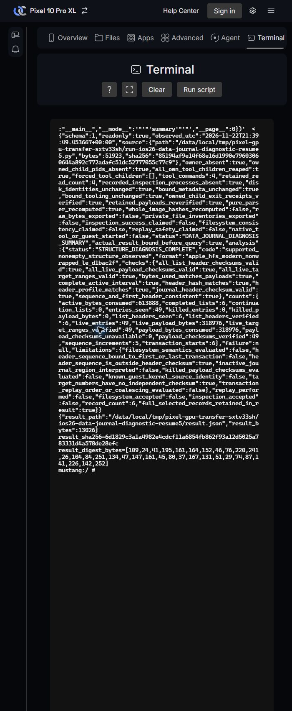

# Completed Data journal structure diagnostic

## Actual outcome

**The one read-only diagnostic completed cleanly at 2026-11-22
21:35:42.308919 UTC.** Its status is `READONLY_DATA_JOURNAL_DIAGNOSTIC_OBSERVED`;
the pure parser reports `STRUCTURE_DIAGNOSIS_COMPLETE` with code
`supported_nonempty_structure_observed`. The saved Data journal contains six
supported transaction-start lists and 49 live payload entries. All nine
reported structure checks passed. **The saved filesystem inspection remains
`INCOMPLETE` and unaccepted: no journal replay or filesystem check has occurred.**

The actual retained result is **13,026 bytes**, SHA-256
`6d1829c3a1a4982e4cdcf11a6854fb862f93a12d5025a783331d4a578de28efc`, at
`/data/local/tmp/pixel-gpu-transfer-sxtv33sh/ios26-data-journal-diagnostic-resume5/result.json`.
The receipt's full digest, including all 32 decimal bytes, was independently
checked against the terminal. Sources and transport were published before
execution at
[`caf8e1757ac75a272a5577ae578d7a9918c7c560`](https://github.com/Ripthulhu/asoft-ios-android/commit/caf8e1757ac75a272a5577ae578d7a9918c7c560).

See [the selected execution evidence](physical-observations/execution-selected.json),
[its independent review](physical-observations/independent-execution-evidence-review.json),
and [the actual result-pin evidence](physical-observations/result-pin-selected.json).
Do not relaunch this diagnostic or any completed firstboot, inspection or observer.

## Observed active records

The journal's active nonwrapped interval runs from byte **512** to byte
**614,400**, occupying **613,888 bytes**. Six 49,152-byte list headers plus
318,976 payload bytes account for that entire interval. All 49 live payload
checksums were available and verified; all 49 live target ranges fit within
Data. There are no killed entries or continuation lists. All six headers have
flags `3` (checksums and first-header), valid list checksums, exact byte
accounting and consistent sequence/first-header relationships.

| List index | Journal offset | Total list bytes | Live entries / verified payload checksums | Payload bytes |
| --- | ---: | ---: | ---: | ---: |
| 0 | 512 | 111,104 | 9 | 61,952 |
| 1 | 111,616 | 78,336 | 5 | 29,184 |
| 2 | 189,952 | 107,008 | 9 | 57,856 |
| 3 | 296,960 | 119,808 | 11 | 70,656 |
| 4 | 416,768 | 102,912 | 8 | 53,760 |
| 5 | 519,680 | 94,720 | 7 | 45,568 |
| **Total** | | **613,888** | **49** | **318,976** |

The [actual-bound summary](physical-observations/bound-summary-selected.json)
was observed at **21:39:49.453667 UTC**. The two
[selected record pages](physical-observations/lists-selected.json) were observed
at **21:42:49.447133 UTC** and **21:43:13.664523 UTC**. Each detailed reader
bound the exact result and source bytes before reading, verified the four
retained extracts and owned-child receipts, reran the pinned pure parser on
those retained bytes, required the same complete analysis, and checked
preservation again. It started no new native image tool or guest VM.

## Clean execution and preservation

The exact reviewed sources were installed through nine source-only stages,
then the separate launcher was submitted once. The host performed precisely
four native image-tool reads: the current Data primary header (512 bytes),
alternate header (512 bytes), JIB (4,096 bytes), and journal (8,388,608 bytes).
All four children completed and were reaped. No child was forced; execution
and preservation errors are null. The later bound readers verified that the
diagnostic owner, owned child PIDs, and prior recorded inspection processes
were absent.

Backing-file identities, bound metadata and tooling remained unchanged. This
bounded diagnostic rechecked identities and the prior full-hash records; it
**did not recompute whole-image hashes**. The earlier resume5 inspection's
full-chain preservation evidence remains separately bound and preserved.
The memory and storage floors, ownership limits and existing locks were not
relaxed. There was no guest boot, mount, replay, repair, filesystem checker,
manual thaw, unrelated process termination or policy change in this diagnostic.

Raw images, journal extracts, payloads and private file inventories remain off
the repository. Public evidence is limited to reviewed sources, selected
metadata, hashes and task screenshots. The retained read hashes are recorded
in the selected execution evidence; they do not disclose the retained bytes.

## What this establishes and what remains

The supported structural profile is consistent across all active records.
That result does not establish filesystem consistency or replay safety. The
parser does not evaluate destination overlap/coalescing, filesystem semantics,
inactive journal contents or the journal header's sequence relationship to
the first or last transaction. Target block numbers have no independent
checksum in this format, and the exact running guest kernel source identity
has not been established. Those limitations are explicit in every result.

The [resume5 saved inspection](../RESULT.md) passed the strict raw iOSRoot
initialization gate and refused Data's nonempty journal before either forced
read-only filesystem check. That refusal remains valid. The pinned Linux
hfsprogs implementation has no journal replay implementation; rerunning the
same inspection cannot consume the pending transactions.

The next implementation requires a separately reviewed recovery mechanism on
a **fresh copy-on-write descendant**, with the entire original chain and all
receipts preserved. Its replay semantics and clean shutdown must be established
before a new read-only inspection can accept both filesystems. No recovery
write or replay implementation is released by this result. Native EL0 plus
kernel TCG remains mandatory; there is no TCG-only fallback. App, GPU and APK
gates remain closed.

## Validation and evidence

The exact parser and host passed 29 and 31 focused tests respectively, with
independent reruns and source review. The source transport passed 14 focused
tests and independent byte-for-byte reconstruction/review. The result readers
passed 11 focused tests and an independent rerun; their actual-result binding
was then independently reviewed. Physical installation, execution, result pin,
summary and both record pages have their own retained screenshots and reviews.
These source tests support implementation review; the physical observations
above establish what actually ran.

