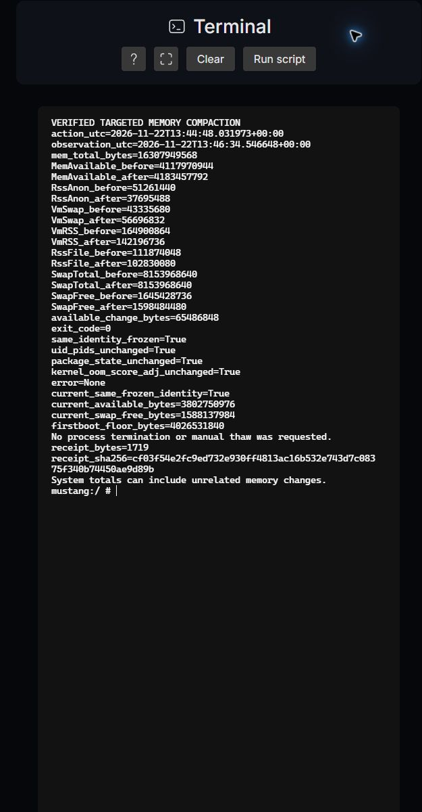

# Recovery checkpoint after the development workspace disconnected

**Physical observation: 2026-11-22 13:46:34 UTC.** Preparation and the separate partition audit remain accepted. Firstboot attempts `07-0001`, `07-0002` and `07-0003` remain incomplete and preserved. There is no accepted firstboot checkpoint, no saved-firstboot inspection and no final APK. `gpu_path_complete=false`.

The development executor became unavailable while a new, separately named memory1 adapter/capture package was undergoing final transport review. No memory1 source was installed, no new preflight was run and no execution owner was released. The next possible attempt is **07-0004**, after restoring access, completing review and satisfying all unchanged physical gates.

This is an additive recovery record published through the repository connector. It preserves selected observations and review status that were available after the executor disconnected. It is **not** a full publication of the pending local source/evidence files and has no matching local commit/tree claim. The last fully matched publication was local `44ecb7a7df64ce7d5baef0b73cb4731418aa7e02` / remote `55dda83aeba4f510585ee7473cb38c29319fac9b`, tree `15d8351edce2b795b44ee955d3cc34d92a83abf2`.

## Safe memory reclamation: measured result

The user requested safe RAM reclamation and confirmed the 16 GB phone. The kernel reported **16,307,949,568 bytes** total RAM. That total does not mean all memory is presently available to a new VM.

One normal Android full-compaction request was made for a freshly checked frozen, cached-empty app. The process identity, frozen state, UID membership, package state and kernel OOM score remained unchanged. No process termination, manual unfreeze, cache drop, global setting or memory-floor change was requested.

| Measurement | Before compaction | After compaction |
| --- | ---: | ---: |
| MemAvailable | 4,117,970,944 B | 4,183,457,792 B |
| Target anonymous resident memory | 51,261,440 B | 37,695,488 B |
| Target swapped memory | 43,335,680 B | 56,696,832 B |
| Target resident memory | 164,900,864 B | 142,196,736 B |
| System free swap | 1,645,428,736 B | 1,598,484,480 B |

The observed system-wide MemAvailable increase was **65,486,848 bytes / 62.453125 MiB**. This is not exclusive attribution to that app. Its anonymous resident memory fell by 13,565,952 bytes while swapped memory rose by 13,361,152 bytes. The compaction record advanced from `lastCompactTime=40305020` to `79642508`, with profile `FULL`; no pending compaction was recorded before or after.

At **13:46:34 UTC**, the same target was still frozen with the original identity, but system MemAvailable had fallen to **3,802,750,976 bytes / 3,626.586 MiB**. That is **213.414 MiB below** the unchanged firstboot floor of **3,840 MiB / 4,026,531,840 bytes**. This observation does not authorize a new VM launch.

The system's free-swap ratio was below 20% after the compaction. The pinned Android source retains its low-swap downgrade, so no further full-compaction request was made. An earlier targeted background-trim callback returned zero but showed no useful RAM gain. A proposed background-process cleanup refused its eligibility gate before action; subsequent readings showed AMS adjustment `set=0` and kernel `oom_score_adj=0`. No app was killed.

The [selected memory metadata](memory-observation.json) and [terminal proof](memory-compaction.jpg) preserve the measured result. Private app/process inventories and the raw app-specific receipts are not included.

The phone retains the raw compaction receipt at:
`/data/local/tmp/pixel-gpu-transfer-sxtv33sh/android-cached-compaction-01.jsonl` (1,719 bytes).
Do not replay the action: its exclusive receipt intentionally prevents repetition.

### Android source basis

The examined source was AOSP Android 17 commit `94b4c163b7dfe5ce3607f7bb8456f9573f7de57d`:

- [ActivityManagerShellCommand.java](https://android.googlesource.com/platform/frameworks/base/+/94b4c163b7dfe5ce3607f7bb8456f9573f7de57d/services/core/java/com/android/server/am/ActivityManagerShellCommand.java): numeric-PID compaction submits an asynchronous one-shot FULL/SHELL request.
- [CachedAppOptimizer.java](https://android.googlesource.com/platform/frameworks/base/+/94b4c163b7dfe5ce3607f7bb8456f9573f7de57d/services/core/java/com/android/server/am/CachedAppOptimizer.java): ordinary compaction throttles are bypassed for this one request; low-free-swap downgrade remains active; no global policy is changed.
- [Native CachedAppOptimizer](https://android.googlesource.com/platform/frameworks/base/+/94b4c163b7dfe5ce3607f7bb8456f9573f7de57d/services/core/jni/com_android_server_am_CachedAppOptimizer.cpp): the existing reclaim path uses page-out/cold advice or process profiles.

The shell's printed “finished” message alone is not completion proof. The retained process identity, advancing optimizer record and actual footprint changes are the observations used here. This was an app-memory action; no guest disk or checkpoint was changed by it.

## Counter1 preflight digest correction

The accepted 13:02:27 UTC preflight stdout is **21,988 bytes**, with actual SHA-256:

`42a0fefd327fd8be51eebb9be6fac4def61a18f5cf8bb274af23d6c093cbe222`

Checkpoint8's selected visual transcription instead copied `d` where the actual digest has `b` at zero-based character 20. The original capture, source and preflight were unchanged. Direct grouped-hex and all-32-decimal-byte observations at 13:15:49 established the corrected value. The original published evidence remains historical; it must not be used as the current execution pin.

The v1 outer owner (35,614 bytes, SHA-256 `e78766a3ea3d71064a2866e8e8bf2a7060af85f5384f05d0d61699b1a398ba6d`) was installed at 13:12:57, but its launcher refused the incorrect pin before owner/work/launch/log/attempt creation.

The separately installed pin1 source changed exactly one source byte at offset 1,837 and retained all execution rules. It is 35,614 bytes, SHA-256 `b7337a992b5c9c651aae1085c358a27c5d2c8b41998398afd5a4f5ba40c6e2e7`, at:
`/data/local/tmp/pixel-gpu-transfer-sxtv33sh/run-ios26-firstboot-owner-counter1-pin1.py`.

## Preserved 07-0003 memory refusal

Pin1 installed at **13:19:05 UTC** and launched at **13:19:17.776382 UTC**. The owner was PID 28120/start 7858275 and its guard PID 28121/start 7858299. The launcher observed 4,048,179,200 bytes available RAM. During the subsequent input validation, available RAM fell.

At **13:21:30 UTC**, the frozen runner refused startup with **3,818 MiB available and 3,840 MiB required**.

The outer owner exited 2 at **13:21:30.877809 UTC**, reaped its guard without force and reported no cleanup errors. Guard result remained `INCOMPLETE`, bound inputs unchanged and checkpoint absent. The adapter restored its process-local Python attributes and recorded unchanged sources.

There was **no QEMU launch** for 07-0003. Only `stage-inputs.json` and `vm-result.json` were present. `launch.json`, `vm.child.json`, `stage-result.json`, the firstboot checkpoint and `07-0004` were absent in the observed failure inventory. Missing/null QEMU cleanup fields are not evidence of a QEMU exit or a guest shutdown.

The 13:21:53 status observation found the recorded wrapper and guard identities absent. No later owner/VM launch was dispatched in this session. The [selected failure pins](failure-pins.json) preserve the independently decoded raw-file identities; any new owner must freshly validate the phone files before using them.

Preserved paths:

| Purpose | Phone path |
| --- | --- |
| Failed counter1 guard work | `/data/local/tmp/pixel-firstboot-guard-e9cc754-counter1` |
| Failed outer owner directory | `/data/local/tmp/pixel-gpu-transfer-sxtv33sh/ios26-firstboot-owner-counter1` |
| Existing accepted partition audit | `/data/local/tmp/pixel-audit-e9cc754` |
| Preparation and failed attempts | `/data/local/tmp/pixel-prep-e9cc754` |

Do not rerun the failed owner or reuse those paths for another attempt.

## Memory1 package: exact review boundary

The guard remains 25,686 bytes / SHA-256 `ea40638312d6ac41607806ecb03c148fbd0677df6ab01480e13fd40536869674`. The saved inspector remains 26,030 bytes / `2b127ecda390b199287358cdad7e6e7774f5b787148aea524e7b0247a2640cf3`. No change to guest size, native execution, counter acceptance or resource thresholds is part of memory1.

| Artifact | Last known identity | Review status at disconnect |
| --- | --- | --- |
| Path-only memory1 adapter | 9,101 B; `627b35efcc9c45559619568d465f26dc511ca3ce3d153e97c019abe6cfed1aef` | Independently reviewed; memfd behavior/restoration unchanged |
| Adapter installer | 8,678 B; `8d395ba9ae7cd28be4b5e2f18c523cafe7cb7e2d5377857fbaa06b917b1ebc9a` | Embedded adapter independently reconstructed |
| Repaired read-only capture | 27,085 B; `6cf4ac2ff53fb88a8db23f7f8183fbda6dc8de09c4fc1f988d69dddd47b2f63b` | Author validation complete; final independent file/transport review pending |
| Blocked owner draft | 37,091 B; `2e3649de3bd67741da77f794798caab6eef36a714e8f5af3a9f8ad25d919081d` | Preservation/core diff reviewed; actual new-preflight pin missing; no launcher released |

Review found stale `FAILED_*` checks in the first capture draft. The author corrected them and reported successful static-name and chunk reconstruction checks. Final independent review of that repaired capture, direct adapter command, three-chunk reconstruction, assembler and preflight-only arguments was interrupted by executor unavailability. These are pending checks, not execution clearance.

The author package is `/workspace/scratch/abcabc3f01ae/memory1-owner`. Its direct adapter command is 7,629 bytes / SHA-256 `076dba4ea80b22d0d023024f9498f50a4ba8bca45c59f1c6560717a891f8a876`. The three-chunk transfer manifest is `e7d4fb2b0190faffcf47157bc8e5bb723942152721b8c52dc2eb09d562bf1892`; final assembly/capture command is 2,569 bytes / `69fbd4b8cfe62595d581fb30e4d9f06789ab4edab66c2e7cff0c3fd1904e4e77`. Transfer commands are at most 5,821 bytes. These identities are recovery references; final independent transport review is still pending. A README-only write was interrupted and its completion must be checked when access returns.

New intended names, all still unstaged:

- Guard work: `/data/local/tmp/pixel-firstboot-guard-e9cc754-memory1`
- Adapter source: transfer base + `run-ios26-firstboot-memfd-adapter-memory1.py`
- Read-only capture prefix: transfer base + `ios26-firstboot-guard-preflight-memory1`
- Owner source/directory: transfer base + `run-ios26-firstboot-owner-memory1.py` / `ios26-firstboot-owner-memory1`
- Sole next attempt: `07-0004`

The new preflight must print all 32 digest bytes as decimal as well as grouped hexadecimal. It cannot reuse the old capture as proof of the fresh adapter/argv/work binding.

## Resume without losing the unpublished work

1. Restore or reopen the development workspace. Preserve the main checkout's uncommitted evidence and scratch author packages before reconciling with this new remote commit. Do not reset or clean the unavailable checkout.
2. Read the current remote branch head and this note first. The old local head was `44ecb7a7df64ce7d5baef0b73cb4731418aa7e02`; its matching remote base was `55dda83aeba4f510585ee7473cb38c29319fac9b`.
3. Recover pending main changes: CONTINUE-PIXEL and recovery/firstboot-counter README updates; the explicit preflight-pin erratum; `firstboot-counter/owner-v1-rejected/`; `firstboot-counter/owner-pin1/`; and `firstboot-memory/`. Those completed local records were not fully published by this emergency checkpoint. The original firstboot-memory failure-pin file was reported with SHA-256 `9357814109ab891fc898dee9c33e2b5cfc97245ced660124cbbb15ff6cbf544f`; verify its actual bytes on recovery rather than assuming this selected reconstruction is identical.
4. Keep private RAM/app/process inventories out of the public export. The `counter-owner/physical-incoming/` directory contains both public-safe and private diagnostic material and must not be copied wholesale.
5. Finish exact memory1 transport review before installing or running its read-only capture. Freshly inspect the phone's current resources and process identities. Only release a new owner against the actually observed new capture and all three preserved failures.
6. Retain fresh firstboot RAM floor 3,840 MiB, running floor 512 MiB, guest 3 GiB/4 CPUs and all ownership/native/sync/counter requirements. A single earlier above-floor reading is insufficient. Do not lower the gate to get past memory pressure.
7. After a genuinely accepted new firstboot, rebind and finish the saved-inspection owner against that exact success and run its own read-only preflight. The saved-firstboot inspection must pass before any later Linux disk mutation. Later app/GPU/wallpaper/locale/pack/final-coldboot gates remain open.

The host check remains separately blocked by self `process_vm_readv` returning `EPERM` after 2,805 tests passed. No new host check, security-policy change or test exemption was requested. The complete GPU integration and macOS behavior gates remain open.
