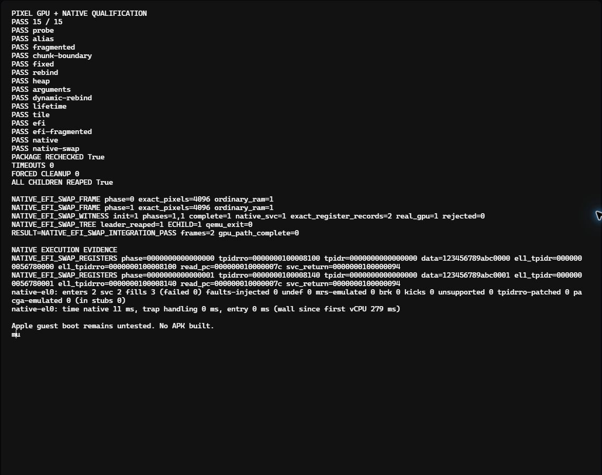

# Physical Pixel run with iOS native swap semantics

**Status: `DEVICE_AUTHORED_SUITE_PASS` — all 15 cases passed in one run.**
The expanded package ran on the Pixel 10 Pro XL's system PowerVR D-Series
DXT-48-1536 MC1 driver. It reuses the runtime from the earlier fourteen-case
qualification and adds an independent authored iOS TPIDRRO swap-mode fixture.
The 6.187064-second recorded interval is diagnostic elapsed time, not an iOS boot
or performance benchmark. No timeout or forced descendant cleanup occurred;
every child was reaped and all 33 package files were rechecked after execution.

[`summary.json`](summary.json) links the exact original reports and logs and
records source, executable, package, device and driver identities. The installed
C API probe again passed all seven checks with a fresh verified challenge on
Vulkan 1.4.344, vendor 4112, device 1896223250 and driver 6967606.

## What the additional case establishes

The `native-swap` supervisor selects `ASOFT_NATIVE_EL0_TPIDRRO=1`, with no generic
TPIDRRO trap switch. Its authored guest runs twice and reports actual register
reads and loaded memory values after each SVC return:

| Witness | First entry | Second entry |
|---|---|---|
| Thread-data pointer read through TPIDRRO | `0x100008100` | `0x100008140` |
| Value loaded through that pointer | `0x123456789abc0000` | `0x123456789abc0001` |
| Native TPIDR CPU hint | `0` | `0` |
| Saved guest TPIDR after native return | `0x56780000` | `0x56780001` |
| Register-read PC | `0x10000007c` | `0x10000007c` |
| SVC-return PC | `0x100000094` | `0x100000094` |

Saved guest TPIDRRO also matched each pointer. Generic-trap or TCG execution
would return the nonzero guest TPIDR sentinel and fail this fixture. The final
QEMU counters independently reported two native entries and two SVC returns.
The supervisor checked every pixel of two 64 by 64 frames, the GPU completed two
matching prepared/finished epochs with 32,768 uploaded bytes, QEMU exited zero,
and the process-tree check reached `ECHILD`.

The other fourteen cases passed again: probe; alias, fragmented and
chunk-boundary addresses; fixed-function operations; buffer and heap rebinds;
argument handles and dynamic rebinding; resource lifetimes; authored tile
rendering; contiguous and fragmented EFI frames; and generic-trap native EL0.
Both original generic-trap binaries are byte-for-byte identical to the earlier
qualified package. Host build/parser evidence is in
[`../../host-checks/native-swap-fixture.json`](../../host-checks/native-swap-fixture.json).

This authored swap fixture uses one native worker and two entries. It does not
establish a full iOS boot, app-UID execution, a larger worker pool or execution
of PAC instructions. The runtime capability trio remains false, the app proof
asset is absent, `gpu_path_complete` remains false, and no APK was built.

## Exact evidence and transfer

The `raw/` directory preserves all **43 exported UTF-8 files byte for byte**.
[`raw-sha256.json`](raw-sha256.json) covers every file, including the phone's
42-file export manifest. The verified 20,394-byte compressed export has SHA-256
`a11204de69791b70432ea8e8acf22ad10899e80115f0c4108af3d998b0a01014`.
Every original file hash, case-log hash, required result marker, package file
identity and native register record was checked after copying.

The update archive was only 26,317 bytes because the verified v2 installer reused
unchanged files already on the phone. Its SHA-256 is
`cb5ab44001e371c7ce13233517fd5745e98385218536bf4fb0f0e65ab5ad7004`;
the update manifest is
`8af96cd4ec766b315ca55b4ab28e6ee043d5804050d9bcb361ca051982182c31`.
Actual local reconstruction and phone reconstruction both verified all 33 files
and rechecked the unchanged baseline. Installation records retain their earlier
not-yet-executed status; the later aggregate execution report is
[`raw/qualification-swap-2a04355/qualification.json`](raw/qualification-swap-2a04355/qualification.json).
Logs contain authored diagnostics and device/build details, not Apple binaries,
guest shader code, credentials or personal content.

## Resume here

| Source | Committed revision |
|---|---|
| reims | `afdbdd0c3c13710bf0565ef9365f0a9d890b207d` |
| metal2vulkan | `51c322d883ea723d290c931b3b2013c50f5e4934` |
| QEMU | `755b88fad8a2771a8e3e207133a54898b740cd7f` |
| App fixture integration | `3e72127e7f684d52ad8b670367f171476cbe745a` |

- Phone package: `/data/local/tmp/pixel-gpu-transfer-sxtv33sh/pixel-cpu-shadow-l4vs6apc/cpu-shadow-qualification`
- Phone results: `/data/local/tmp/pixel-gpu-transfer-sxtv33sh/qualification-swap-2a04355`
- Local package: `/tmp/pixel-cpu-shadow-package-swap-2a04355/cpu-shadow-qualification`
- QEMU SHA-256: `b7760144c955fe08278172dc92ca0f0294fdc80f601ebef7b35e31510f93625a`

Next, qualify a separate candidate with the guest-facing buffer, heap and
detach capability trio enabled through real C API/MMIO traffic, then rerun the
physical suite on that exact runtime. The capability change also requires a
cold Apple-guest boot before product integration.

The read-only [`phone asset preflight`](raw/ios26-preflight-swap-2a04355.json)
found no guest files in the three expected iOS26 roots and no image matches in
the checked download/temporary directories. Neither `com.asoft.ios` nor
`com.asoft.ios.dev` was installed, and both resumable setup roots were absent.
An actual boot therefore needs prepared matching guest assets or the established
image preparation pipeline first. Once the exact final runtime passes product
and app-UID qualification, bind the app proof to its hash and device/driver
identity; build the final APK only after those GPU gates are complete.
